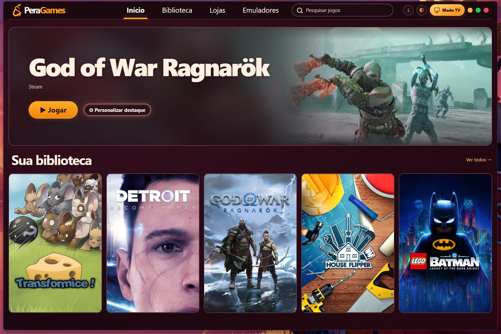
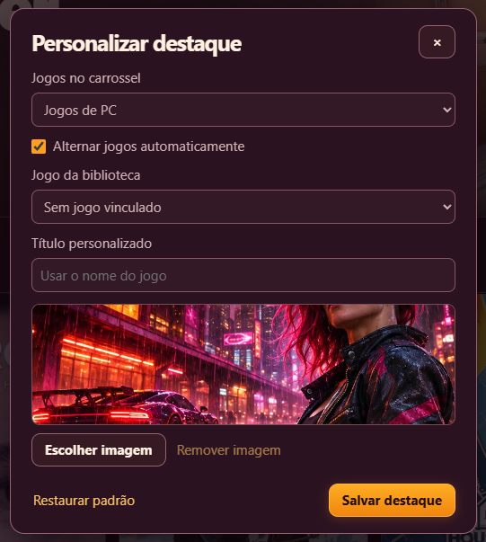

# PeraGames

[Leia em português](README.md) · [GitHub releases](https://github.com/PeraTV/PeraGames/releases)

PeraGames brings PC games, emulators, and store shortcuts together in one library. Use the desktop interface or switch to TV Mode with a keyboard, mouse, or controller.

## Installation and updates

Choose the installer for your system on the releases page. After installation, use the download icon in the PeraGames header to **check for app updates**. The **Refresh** button in the library rescans your game catalog.

| System | First installation | Updates |
| --- | --- | --- |
| Windows x64 | Run the published .exe installer. | The app downloads and opens the new installer. |
| Linux x64 or ARM64 | With Flatpak installed, open the .flatpak bundle for your architecture. Flathub provides the runtime. | The app downloads the new bundle and asks Flatpak to install it. |
| macOS Intel or Apple Silicon | Open the universal .dmg and drag PeraGames to Applications. | In-app installation is available for releases signed for distribution. |

## Library and customization

| | |
| --- | --- |
| **PC library**  | **Stores and tools**  |
| **Emulation hub**  | **Game information and favorites**  |
| **Custom spotlight**  | **Color palettes**  |

Use **Add game** in the library to register an executable or shortcut. Open **Emulators** to import ROMs and browse systems. Store and emulator availability depends on your operating system.

## TV Mode

Choose **Amber Cinema**, **Amber Panel**, or **Amber Gallery** in **Appearance**. Press **A/Enter** to select, **B/Esc** to go back, or **Y** to view game information and add it to your favorites. Use **LB/RB** on a controller to switch pages.

### Amber Cinema

### Amber Panel

### Amber Gallery

## Development

Run `npm install`, `npm test`, and `npm start` in the project directory. Library data and favorites are stored in your local PeraGames profile.
