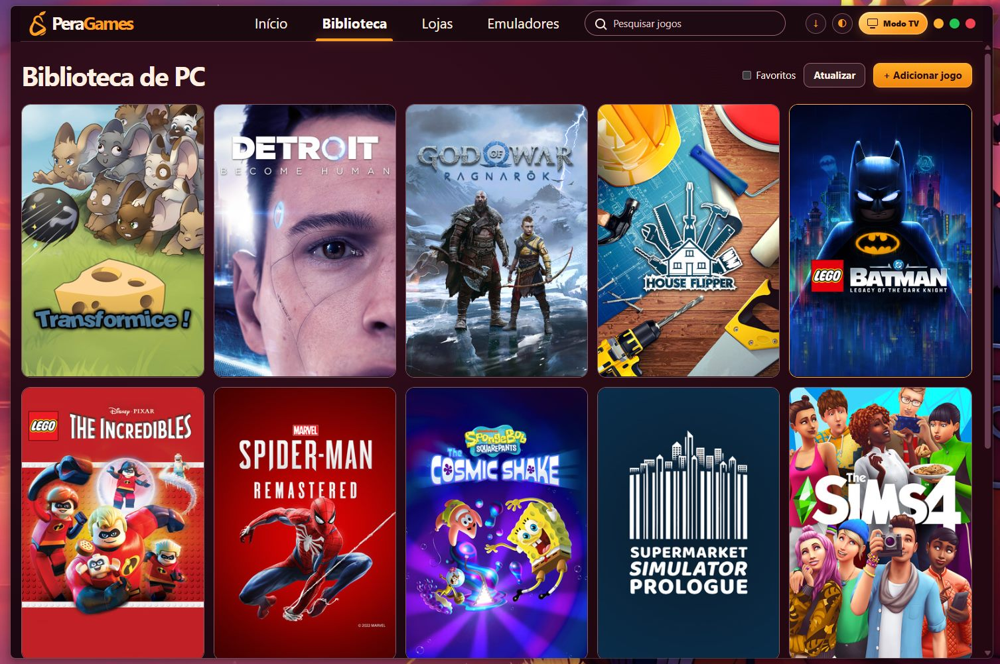
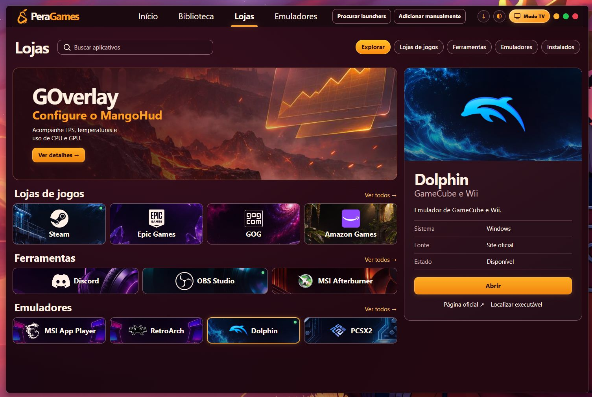
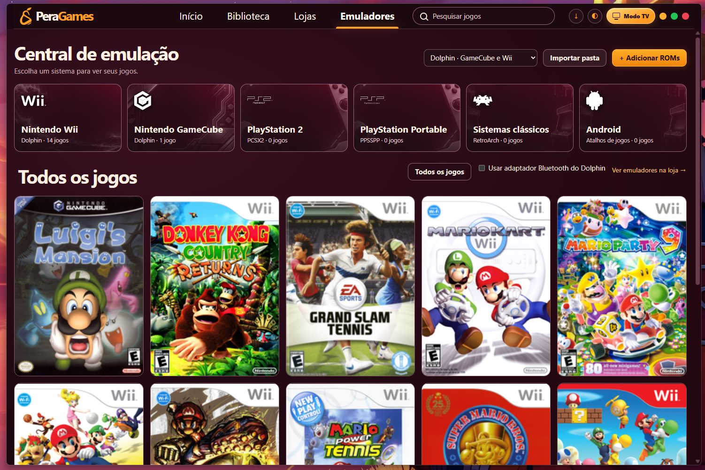
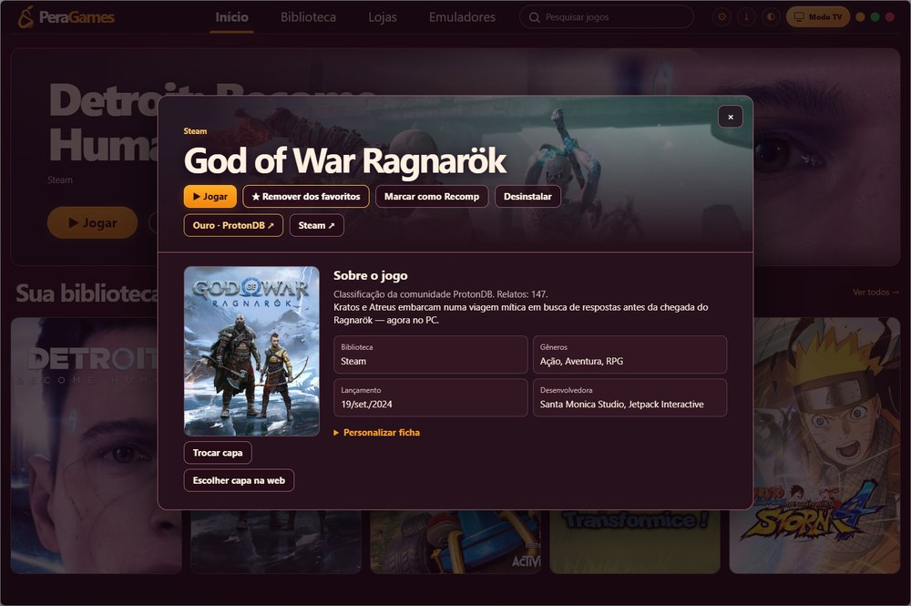
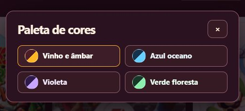
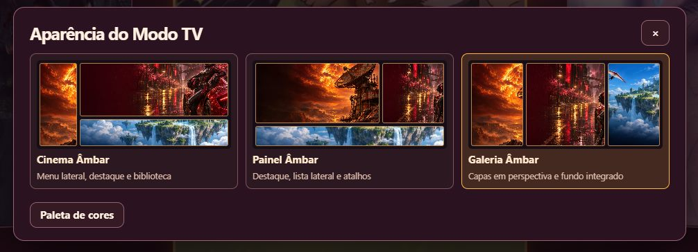
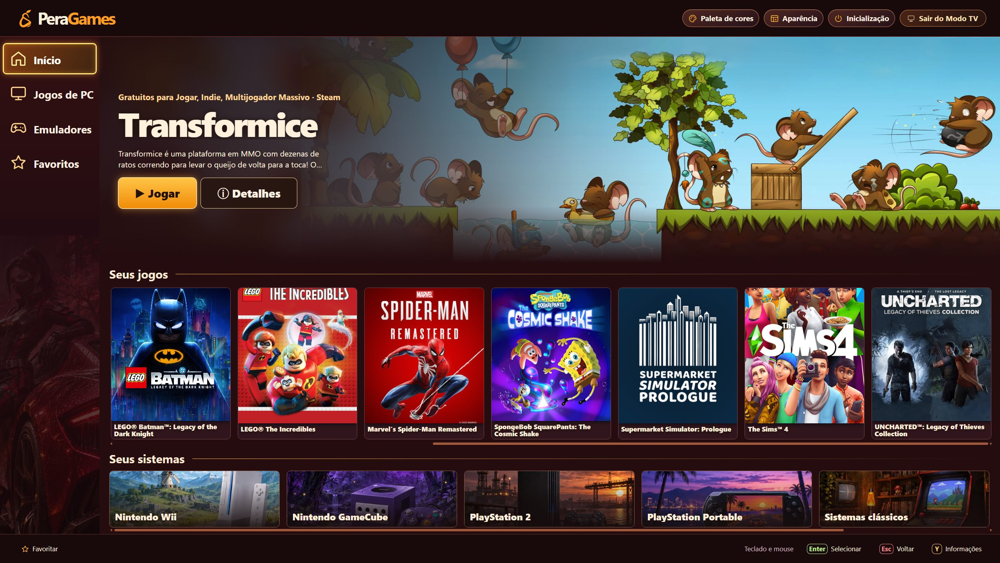
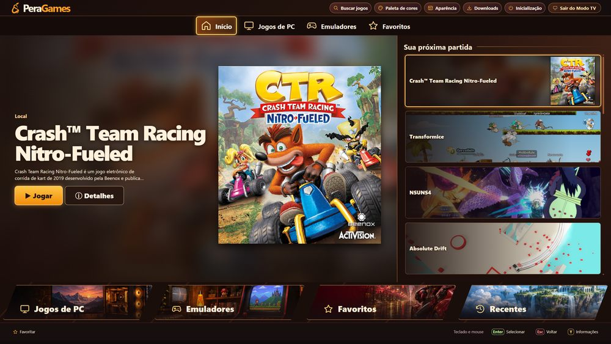
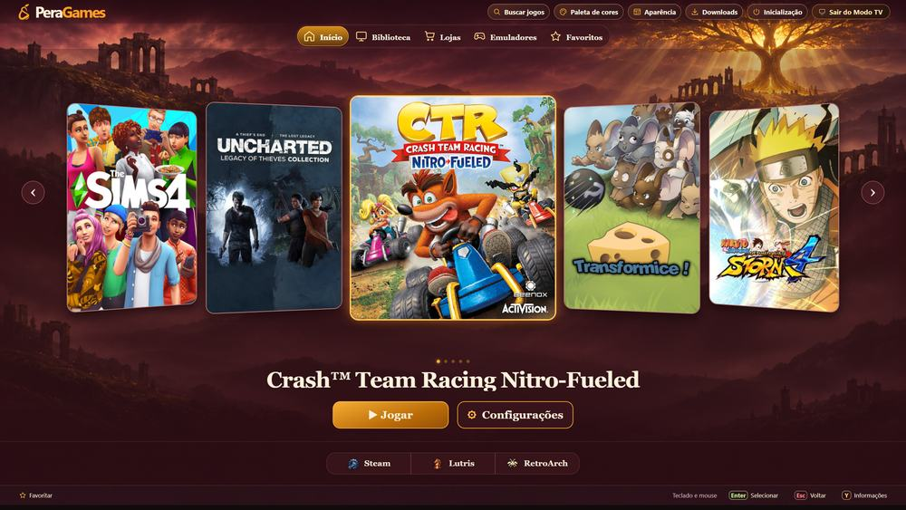

# PeraGames

[Leia em português](README.md) · [GitHub releases](https://github.com/PeraTV/PeraGames/releases)

PeraGames brings PC games, emulators, and store shortcuts together in one library. Use the desktop interface or switch to TV Mode with a keyboard, mouse, or controller.


## Installation and updates

Choose the installer for your system on the releases page. After installation, use the download icon in the PeraGames header to **check for app updates**. The **Refresh** button in the library rescans your game catalog.

| System | First installation | Updates |
| --- | --- | --- |
| Windows x64 | Run the published .exe installer. | The app downloads and opens the new installer. |
| Linux x64 or ARM64 | With Flatpak installed, open the .flatpak bundle for your architecture. Flathub provides the runtime. | The app downloads the new bundle and asks Flatpak to install it. |
| macOS Intel or Apple Silicon | Open the universal .dmg and drag PeraGames to Applications. | In-app installation is available for releases signed for distribution. |

The interface follows your system language. PeraGames opens in Portuguese on Portuguese systems and in English on other systems.

### Linux installation from the terminal

The same bundle works on BigGnome, Manjaro, and other distributions with Flatpak. KDE Plasma and GNOME are desktop environments. Use the command for the distribution that runs your desktop.

| Distribution | If the `flatpak` command is missing |
| --- | --- |
| BigGnome or Manjaro | `sudo pacman -S flatpak` |
| KDE neon, Kubuntu, Ubuntu, or Debian | `sudo apt update && sudo apt install flatpak` |
| Fedora, including Fedora KDE Plasma | `sudo dnf install flatpak` |

Download the `.flatpak` bundle from the [latest release](https://github.com/PeraTV/PeraGames/releases/latest) and run:

```sh
flatpak remote-add --user --if-not-exists flathub https://dl.flathub.org/repo/flathub.flatpakrepo
flatpak install --user ~/Downloads/PeraGames-Linux-x64.flatpak
flatpak run io.github.PeraTV.PeraGames
```

Use the x64 bundle if `uname -m` prints `x86_64`. If it prints `aarch64`, use `PeraGames-Linux-arm64.flatpak` instead. Adjust `~/Downloads` if you saved the file elsewhere. A software manager with Flatpak support can also open the downloaded file. [Distribution-specific setup instructions](https://flathub.org/en/setup).

### Proton, Epic Games, and GOG on Linux

- Install [umu-launcher](https://github.com/Open-Wine-Components/umu-launcher#installation) on Linux. In **Library → Add game**, select the game's `.exe`. Open **Proton compatibility** in the game's details to select a detected version, add your own Proton folder, or use an existing Wine prefix. **Latest GE-Proton (automatic)** lets UMU get the current release when you play. **Check for GE-Proton releases** shows the latest published version.
- Open **Stores → Epic Games/GOG → Store library**, sign in through your browser, and paste the resulting code or callback URL in PeraGames. Epic uses [Legendary](https://github.com/legendary-gl/legendary), and GOG uses [gogdl](https://github.com/Heroic-Games-Launcher/heroic-gogdl). Install the components on the host and make `legendary`, `gogdl`, and `umu-run` available on PATH. Install or update compatible titles from the store library. Installed titles appear in the PeraGames library with per-game Proton settings.
- For Steam titles, open the game details and select **Proton**. Exit Steam from **Steam → Exit** before choosing a version or importing a Proton folder. The per-game selection takes effect the next time Steam starts.
- Under **Stores**, **Install on Linux** installs Flathub applications through the system Flatpak. For other providers, PeraGames opens the installation page and offers **Copy link**.

## Library and customization

| | |
| --- | --- |
| **PC library**<br> | **Stores and tools**<br> |
| **Emulation hub**<br> | **Game information and favorites**<br> |
| **Custom spotlight**<br> | **Color palettes**<br> |

Use **Add game** in the library to register an executable or shortcut. Open **Emulators** to import ROMs and browse systems. Store and emulator availability depends on your operating system.

## TV Mode

Choose **Amber Cinema**, **Amber Panel**, or **Amber Gallery** in **Appearance**. Press **A/Enter** to select, **B/Esc** to go back, or **Y** to view game information and add it to your favorites. Use **LB/RB** on a controller to switch pages.



### Amber Cinema



### Amber Panel



### Amber Gallery



## Development

Run `npm install`, `npm test`, and `npm start` in the project directory. Library data and favorites are stored in your local PeraGames profile.
