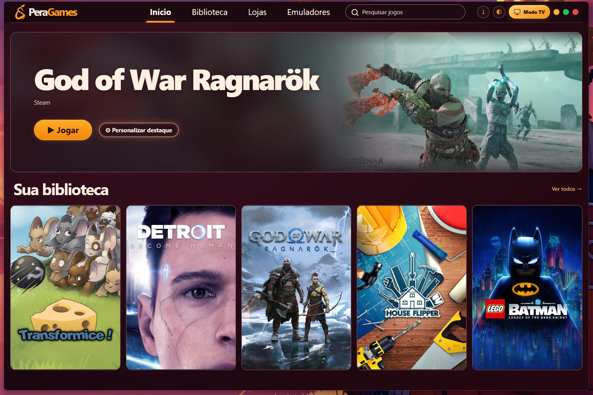
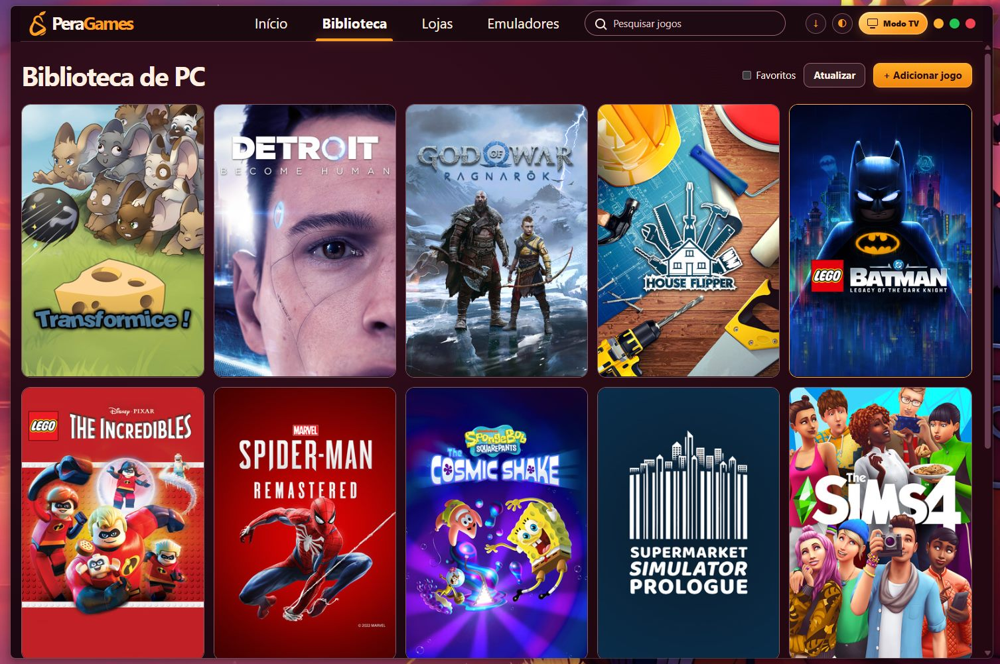
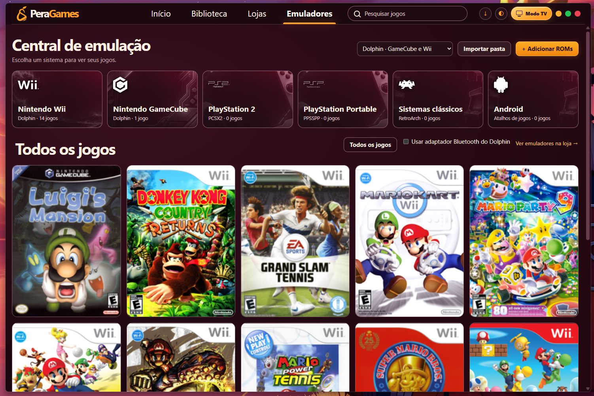
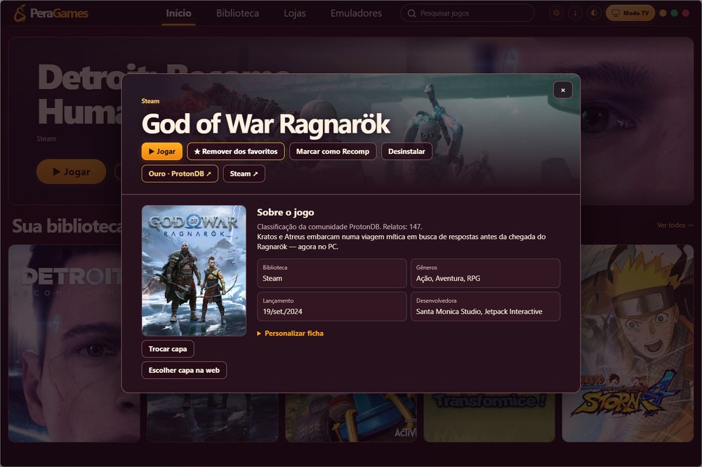
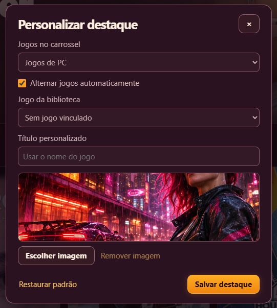
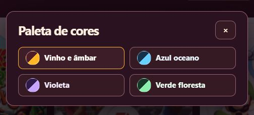
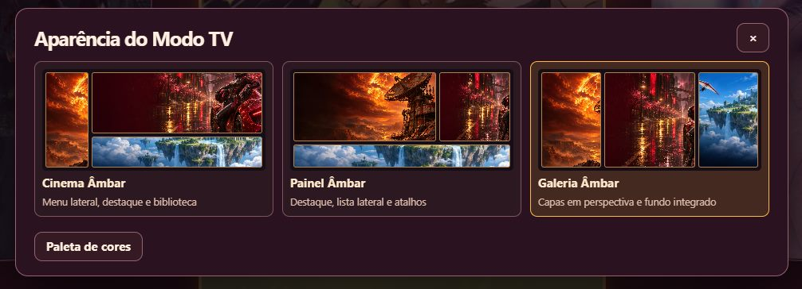
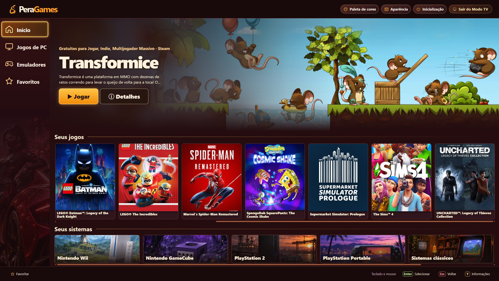
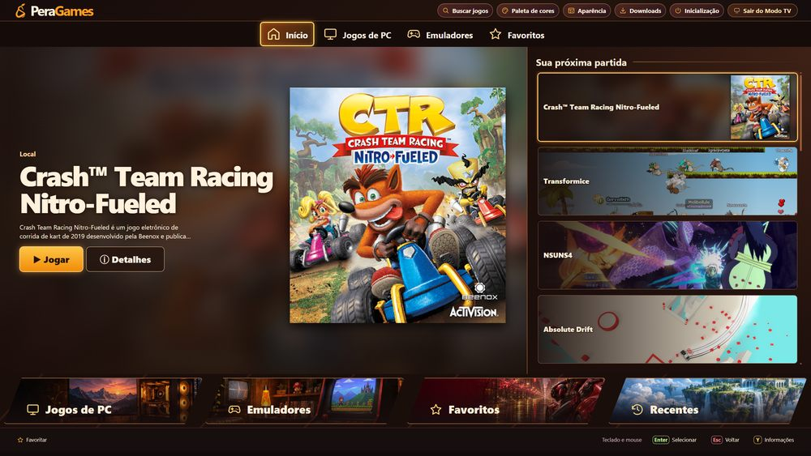

# PeraGames

[Read in English](README.en.md) · [Instaladores no GitHub](https://github.com/PeraTV/PeraGames/releases)

O PeraGames reúne jogos de PC, emuladores e atalhos de lojas em uma biblioteca. Use a interface de desktop ou o Modo TV com teclado, mouse ou controle.

## Instalação e atualizações

Na página de versões, escolha o instalador do seu sistema. Depois da instalação, abra o ícone de download no cabeçalho do PeraGames para **Verificar atualizações do app**. O botão **Atualizar**, na Biblioteca, relê o catálogo de jogos.

| Sistema | Primeira instalação | Atualizações |
| --- | --- | --- |
| Windows x64 | Execute o instalador .exe da versão publicada. | O app baixa e abre o instalador da nova versão. |
| Linux x64 ou ARM64 | Com Flatpak instalado, abra o pacote .flatpak correspondente à arquitetura. O runtime vem do Flathub. | O app baixa o novo pacote e solicita ao Flatpak que o instale. |
| macOS Intel ou Apple Silicon | Abra o .dmg universal e arraste o PeraGames para Aplicativos. | A instalação pelo app fica disponível nas versões assinadas para distribuição. |

A interface segue o idioma do sistema. Em sistemas em português, o PeraGames abre em português. Nos demais, abre em inglês.

## Biblioteca e personalização

| | |
| --- | --- |
| **Biblioteca de PC**  | **Lojas e ferramentas**  |
| **Central de emulação**  | **Sinopse e favoritos**  |
| **Destaque personalizado**  | **Paletas de cores**  |

Na Biblioteca, use **Adicionar jogo** para cadastrar um executável ou atalho. A importação de ROMs e o acesso aos sistemas ficam em **Emuladores**. A disponibilidade de lojas e emuladores depende do sistema operacional.

## Modo TV

Escolha **Cinema Âmbar**, **Painel Âmbar** ou **Galeria Âmbar** em **Aparência**. Use **A/Enter** para selecionar, **B/Esc** para voltar e **Y** para abrir a ficha do jogo e acessar os favoritos. No controle, **LB/RB** alternam entre as páginas.

### Cinema Âmbar

### Painel Âmbar

### Galeria Âmbar

## Desenvolvimento

Execute `npm install`, `npm test` e `npm start` na pasta do projeto. Os dados da biblioteca e os favoritos ficam no perfil local do PeraGames.
