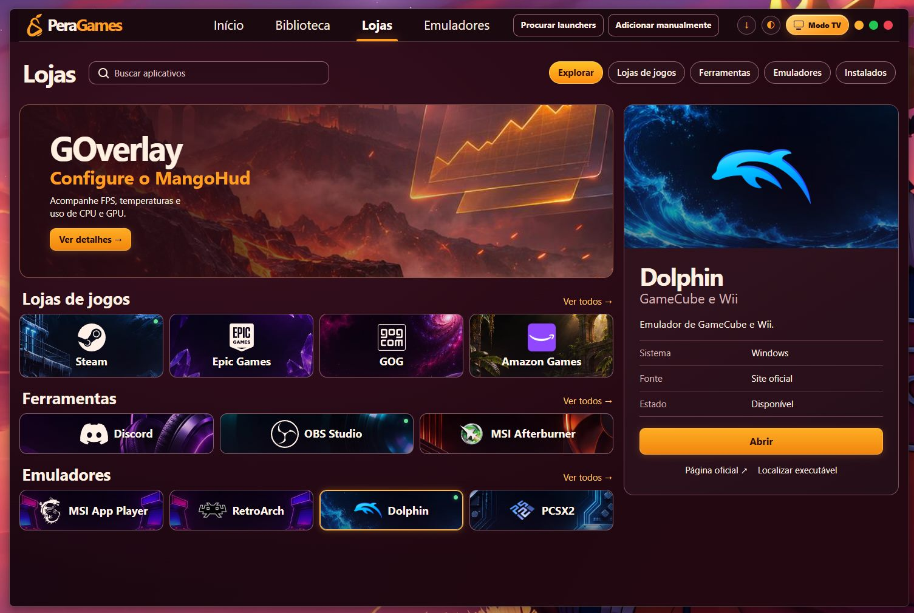

# PeraGames

[Read in English](README.en.md) · [Instaladores no GitHub](https://github.com/PeraTV/PeraGames/releases)

O PeraGames reúne jogos de PC, emuladores e atalhos de lojas em uma biblioteca. Use a interface de desktop ou o Modo TV com teclado, mouse ou controle.


## Instalação e atualizações

Na página de versões, escolha o instalador do seu sistema. Depois da instalação, abra o ícone de download no cabeçalho do PeraGames para **Verificar atualizações do app**. O botão **Atualizar**, na Biblioteca, relê o catálogo de jogos.

| Sistema | Primeira instalação | Atualizações |
| --- | --- | --- |
| Windows x64 | Execute o instalador .exe da versão publicada. | O app baixa e abre o instalador da nova versão. |
| Linux x64 ou ARM64 | Com Flatpak instalado, abra o pacote .flatpak correspondente à arquitetura. O runtime vem do Flathub. | O app baixa o novo pacote e solicita ao Flatpak que o instale. |
| macOS Intel ou Apple Silicon | Abra o .dmg universal e arraste o PeraGames para Aplicativos. | A instalação pelo app fica disponível nas versões assinadas para distribuição. |

A interface segue o idioma do sistema. Em sistemas em português, o PeraGames abre em português. Nos demais, abre em inglês.

### Linux via terminal

O mesmo pacote funciona no BigGnome, no Manjaro e em outras distribuições com Flatpak. KDE Plasma e GNOME são ambientes gráficos. Para instalar o Flatpak, use o comando da distribuição em que seu ambiente roda.

| Distribuição | Se o comando `flatpak` estiver ausente |
| --- | --- |
| BigGnome ou Manjaro | `sudo pacman -S flatpak` |
| KDE neon, Kubuntu, Ubuntu ou Debian | `sudo apt update && sudo apt install flatpak` |
| Fedora, incluindo Fedora KDE Plasma | `sudo dnf install flatpak` |

Baixe o arquivo `.flatpak` da [versão mais recente](https://github.com/PeraTV/PeraGames/releases/latest) e execute:

```sh
flatpak remote-add --user --if-not-exists flathub https://dl.flathub.org/repo/flathub.flatpakrepo
flatpak install --user ~/Downloads/PeraGames-Linux-x64.flatpak
flatpak run io.github.PeraTV.PeraGames
```

Use o pacote x64 se `uname -m` mostrar `x86_64`. Se mostrar `aarch64`, troque o nome do arquivo por `PeraGames-Linux-arm64.flatpak`. Ajuste `~/Downloads` se você salvou o arquivo em outra pasta. Em um ambiente com suporte a Flatpak configurado, também é possível abrir o arquivo pelo gerenciador de software. [Instruções por distribuição](https://flathub.org/pt/setup).

### Proton, Epic Games, GOG e Amazon Games no Linux

- Em **Biblioteca → Adicionar jogo**, selecione o `.exe` do jogo. Na ficha, abra **Compatibilidade com Proton** para escolher uma versão detectada, adicionar a pasta de um Proton próprio ou reutilizar um prefixo Wine. **GE-Proton automático** usa a versão mais recente detectada no computador. Se nenhuma estiver disponível, o PeraGames baixa e verifica o pacote oficial antes de iniciar o [UMU](https://github.com/Open-Wine-Components/umu-launcher). **Verificar GE-Proton** mostra a versão publicada.
- Na mesma ficha, use **Opções de inicialização do jogo** para salvar argumentos, variáveis ou um identificador de compatibilidade por jogo. **Componentes e recuperação do prefixo** instala dependências via Winetricks em uma cópia e permite recriar ou voltar ao prefixo anterior. Para 20XX da Epic, o painel sugere `d3dcompiler_43` e `d3dx9_43`.
- Em **Lojas → Epic Games/GOG → Biblioteca da loja**, conecte a conta pelo navegador e cole o código ou URL de retorno na janela do PeraGames. No Linux, a Epic usa o [Legendary](https://github.com/legendary-gl/legendary) e a GOG usa o [gogdl](https://github.com/Heroic-Games-Launcher/heroic-gogdl). Instale os componentes no sistema e deixe os comandos `legendary`, `gogdl` e `umu-run` disponíveis no PATH. A biblioteca da loja oferece instalação e atualização dos jogos compatíveis. Os jogos instalados aparecem na Biblioteca do PeraGames com configuração individual de Proton.
- Para jogos da Steam, abra a ficha e clique em **Proton**. Feche a Steam pelo menu **Steam → Sair** antes de escolher a versão ou de importar uma pasta de Proton. A seleção vale para aquele jogo na próxima abertura da Steam.
- O botão **Proton** aparece na ficha de todos os jogos de PC no Linux. Se um jogo local abre por um executável nativo, use **Escolher executável do Windows** para associar o `.exe` e iniciar essa versão com Proton. Use **Voltar ao executável original** para retomar a versão nativa.
- Em **Biblioteca → Adicionar jogo**, selecione Windows ou Linux, informe o nome e escolha o executável. Para Windows, você também pode escolher Wine ou Proton e indicar um prefixo existente ou vazio. Use **Rodar instalador primeiro** para rodar o `.exe` de instalação nesse prefixo. Quando terminar, escolha o executável instalado e salve na biblioteca. Argumentos, MangoHud e GameMode podem ser definidos para cada jogo local. MangoHud e GameMode usam os comandos instalados no sistema.
- Em **Lojas**, o botão **Instalar no Linux** instala os aplicativos do Flathub pelo Flatpak do sistema. Quando o aplicativo usa outro distribuidor, o PeraGames abre a página de instalação e oferece **Copiar link**.
- Para alterar o executável ou as opções de execução de um jogo local que já está na biblioteca, use **Editar inicialização** na ficha do jogo.
- Em **Biblioteca → Contas de jogos**, conecte ou sincronize a Epic Games e a GOG. Os jogos da conta aguardando instalação aparecem com capas cinzas e botão **Instalar jogo**. Use **Todos os jogos**, **Instalados** ou **Não instalados** para filtrar a biblioteca.

#### Compatibilidade de jogos Windows fora da Steam

1. Na ficha, abra **Compatibilidade com Proton** e selecione **GE-Proton automático** ou uma versão instalada. O PeraGames salva a escolha para aquele jogo. **Opções de inicialização do jogo** aceita um argumento por linha, variáveis no formato `NOME=valor` e um Steam AppID ou ID UMU.
2. Se o jogo exigir uma biblioteca do Windows, abra **Componentes e recuperação do prefixo**. Confira os componentes sugeridos e confirme a instalação via Winetricks. Para **20XX da Epic**, o perfil sugere o ID `umu-322110` e os componentes `d3dcompiler_43` e `d3dx9_43`. A configuração de vídeo da versão testada apareceu em `Documentos/20XX/20XXv096.opt` no perfil Windows.
3. Feche o jogo antes de instalar componentes, recriar ou restaurar um prefixo. A instalação usa uma cópia e a recriação abre um prefixo vazio. **Restaurar prefixo anterior** volta ao backup e mantém o prefixo que estava ativo. Saves dentro do prefixo antigo só reaparecem ao restaurá-lo ou copiá-los manualmente. Prefixos gerenciados e cópias ficam em `~/.var/app/io.github.PeraTV.PeraGames/config/PeraGames/prefixes/` no Flatpak, ou em `$XDG_CONFIG_HOME/PeraGames/prefixes/` na instalação Linux. Um prefixo personalizado pode estar em outra pasta. Consulte também o armazenamento em nuvem ou fora do prefixo usado pelo jogo.
4. Se houver erro, abra **Diagnosticar jogo** na ficha e clique em **Copiar relatório seguro**. A verificação consulta caminhos, acesso ao host, runtime, Vulkan, bibliotecas de 32 bits e componentes conhecidos. O relatório inclui estados e a etapa da última falha, sem caminhos pessoais, argumentos ou credenciais.

A Epic usa Legendary, a GOG usa gogdl e a Amazon Games usa Nile. O PeraGames usa UMU para jogos Windows com Proton. A compatibilidade depende do jogo, dos drivers e dos componentes instalados. Anti-cheats incompatíveis podem impedir o lançamento ou o modo online.

Para **EA app**, **Battle.net** e **Ubisoft Connect** no Linux, abra a ficha em **Lojas** e use **Baixar instalador do Windows**. Depois abra **Configurar com Wine ou Proton**, escolha o runner e selecione **Rodar instalador primeiro**. Ao terminar, feche o launcher se ele abrir automaticamente. O PeraGames procura o executável no prefixo usado pelo instalador. Confira o caminho e salve para abrir o launcher em **Lojas**. A compatibilidade do login e dos jogos depende do launcher, do runner e da versão instalada.

## Biblioteca e personalização

| | |
| --- | --- |
| **Biblioteca de PC**<br> | **Lojas e ferramentas**<br> |
| **Central de emulação**<br> | **Sinopse e favoritos**<br> |
| **Destaque personalizado**<br> | **Paletas de cores**<br> |

Na Biblioteca, use **Adicionar jogo** para cadastrar um executável ou atalho. A importação de ROMs e o acesso aos sistemas ficam em **Emuladores**. A disponibilidade de lojas e emuladores depende do sistema operacional.

## Modo TV

Escolha **Cinema Âmbar**, **Painel Âmbar** ou **Galeria Âmbar** em **Aparência**. Use **A/Enter** para selecionar, **B/Esc** para voltar e **Y** para abrir a ficha do jogo e acessar os favoritos. No controle, **LB/RB** alternam entre as páginas.


### Cinema Âmbar


### Painel Âmbar


### Galeria Âmbar


## Desenvolvimento

Execute `npm install`, `npm test` e `npm start` na pasta do projeto. Os dados da biblioteca e os favoritos ficam no perfil local do PeraGames.
